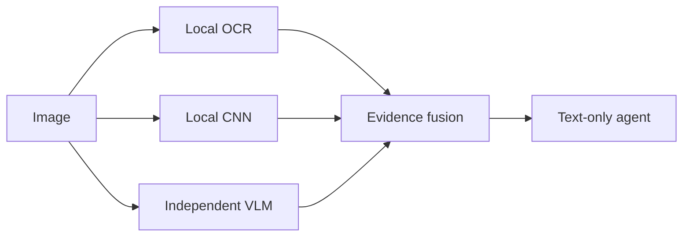

# 我把 AI 的“眼睛”拆成了三块，上下文终于不炸了

有一类 AI 产品 demo 看起来特别聪明：

> 上传截图，AI 告诉你页面哪里坏了。

但真实使用经常变成这样：

> **本轮上下文超过模型的窗口，请缩短输入或更换更大窗口的模型。**

你上传的是一张截图，模型收到的却是一块几 MB 的 base64。截图里真正有用的东西可能只有一句报错、三个按钮和一个灰色状态，但整张图连同历史对话一起挤进上下文，最后连一句“这是什么”都回答不了。

我们决定不再让主对话模型直接“吞图”。

## 三只眼睛，各看各的

NexcoreVision 把视觉理解拆成三个独立层次：



**OCR 看字。**

报错文案、价格、按钮名称、代码、表格里的数字，优先相信 OCR。它不是“猜”，而是在读屏幕上真实存在的字符。

**CNN 看物体和布局。**

MobileNetV3 给出整张图的类别，SSDLite 找到物体、置信度和位置框。它回答的是“画面里有什么”，不负责编故事。

**视觉模型看语义。**

免费或自建的视觉模型负责关系、场景和意图：这是设置页还是聊天页？灰色按钮意味着禁用还是加载中？错误弹窗与哪个输入框有关？

三路结果不会揉成一句看似确定的“AI 总结”。它们带着来源进入一张证据表：

```md
### Local OCR
保存失败：HTTP 401

### Independent vision model
页面显示认证失败弹窗，主按钮处于禁用状态。

### Local deep vision
- desktop computer: 81.0%
- laptop: 72.0% at [20, 300, 800, 1200]

### Evidence rules
图中文字以 OCR 为准；主体与语义参考视觉模型；冲突必须保留。
```

## 真正的关键不是换模型

很多“修复上下文超限”的方案是在换一个更大窗口的模型。

这当然有用，但它没有解决信息流的问题：**为什么语言模型要收到整张图？**

在 NexcoreVision 里，主模型收到的不是图片，而是一份受预算限制的文字证据。图片有 4 MB 还是 8 MB，不再决定主模型能不能继续工作。

```ts
const evidence = await analyzeImage({
  imagePath: "screenshot.png",
  question: "为什么保存按钮不可用？",
  ocr: "auto",
  deep: true,
  vision: myVisionAdapter,
  maxEvidenceCharacters: 12_000
});
```

`maxEvidenceCharacters` 是硬预算。超了就截断，并明确标注截断，而不是让一次截图悄悄挤掉整个任务。

## 为什么还要本地 CNN？

因为只靠 OCR 和云端 VLM，丢失的东西太多：

- 纯图片没有文字时，OCR 什么都给不了；
- 截图里的组件大小、位置和数量，OCR 不负责；
- 只问云端模型，弱模型容易看漏，强模型又贵；
- 云端失败时，整轮任务不应该跟着失败。

本地 CNN 是第三条证据。它便宜、确定、离线，而且能给出物体框和置信度。即使云端视觉端点挂了，主模型仍然能知道“这里有一张桌面截图，检测到浏览器窗口和按钮”。

## 四个工程取舍

### 1. 不把模型权重塞进仓库

权重按需下载，不进 Git，不打进必装依赖。OCR 路径零额外模型；CNN 和 VLM 都是可插拔能力。

### 2. 不伪造“统一真相”

OCR 看到 `ETIMEDOUT`，视觉模型说“网络正常”，怎么办？

保留冲突。让下游模型明确知道哪一句来自 OCR，哪一句来自视觉推理，而不是把两个结果平均成一个不可追溯的答案。

### 3. 不替用户偷偷上传

CLI 不配置视觉端点时只做本地分析。只有用户显式传入 `openAICompatibleVision()`，图片才会进入远程请求。

### 4. 不把失败变成空结果

OCR 失败，VLM 仍可工作；VLM 失败，OCR 和 CNN 仍保留；CNN 不可用，不影响前两层。每一层都可以独立降级。

## 现在已经能做什么

- Windows 原生 OCR，无需额外 OCR 服务；
- 其他平台自动调用开源 Tesseract CLI；
- OpenAI-compatible 视觉模型适配器；
- MobileNetV3 图像分类；
- SSDLite 目标检测与位置框；
- 图像亮度、对比度质量提示；
- 来源分离、冲突提示、上下文预算截断；
- CLI 与 TypeScript API；
- 纯 Node.js 标准库测试，无框架锁定。

## 跑起来

```bash
git clone https://github.com/yan-stone-computer/NexcoreVision.git
cd NexcoreVision
npm test
npm run cli -- screenshot.png --deep
```

接入一个 OpenAI-compatible 视觉端点：

```bash
export NEXCORE_VISION_API_KEY="..."
npm run cli -- screenshot.png --deep \
  --question "这个报错是什么意思？" \
  --vision-base-url https://api.example.com/v1 \
  --vision-model vision-model-name
```

## 这不是“视觉大模型平替”

它解决的不是“让文本模型突然拥有完整视觉能力”。

它解决的是一个更现实的问题：

> 当一个 Agent 需要看几十张截图、几百个页面、几千次报错时，怎样让每一张图都贡献可核验的信息，而不是消耗掉一次上下文窗口？

答案是：把看见的东西变成证据。

不是把所有像素塞进聊天记录。

---

如果你也在做 Agent、自动化测试、UI 审查、文档理解或多模态 RAG，欢迎拿它跑一组真实图片，提交 issue 或 benchmark。

**仓库：** https://github.com/yan-stone-computer/NexcoreVision

MIT License.
